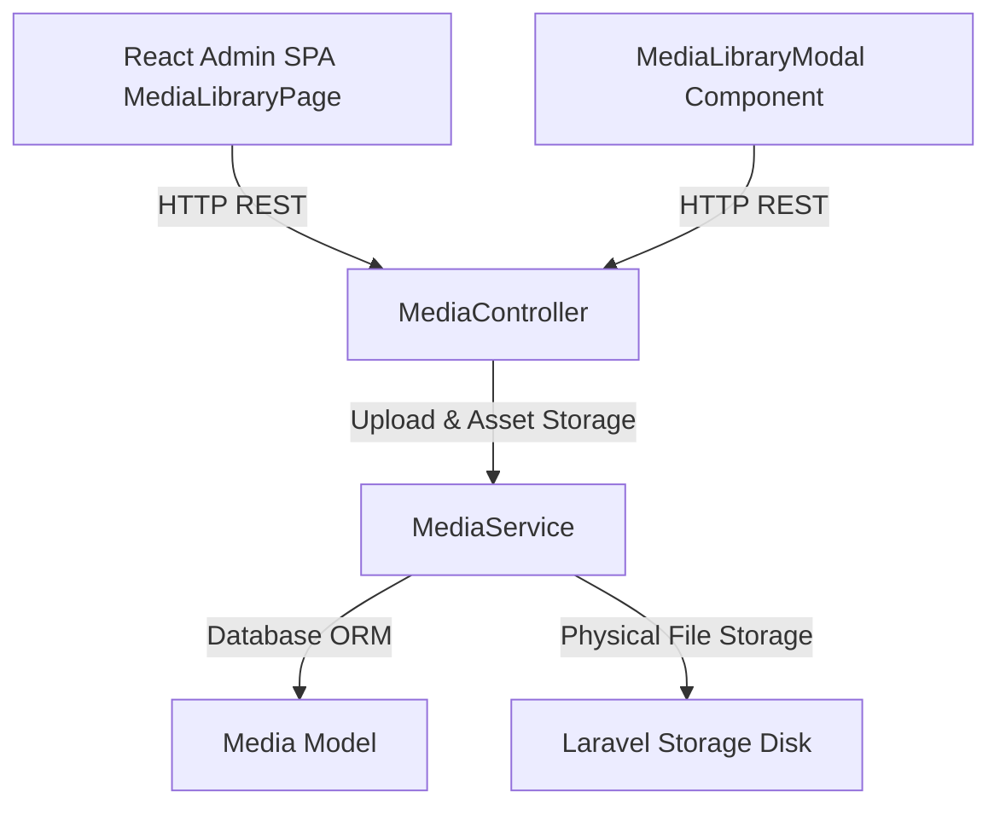

# Development Plan: Module 36 — Admin Media Library

## 1. Module Summary
**Module Name**: Module 36 — Admin Media Library  
**Layer**: Admin API Backend & React Admin SPA Frontend  
**Specification Reference**: `specifications/feature.admin-media.spec.md`  

---

## 2. Development Strategy
Follow the mandatory iterative workflow defined in `instruction.md`:
1. Verify backend API Controller `App\Http\Controllers\Api\V1\Admin\MediaController.php` & `App\Services\MediaService.php` endpoints (upload, list, detail, attach, detach, update, sort, delete, purgeUnused).
2. Create React Admin SPA Page `resources/js/admin/pages/MediaLibraryPage.jsx` featuring:
   - Header with standard `page-header-row`, refresh button, bulk purge action, and file upload trigger.
   - Executive KPI cards (`stat-cards-grid-4`) displaying Total Media Assets, Images Count, Documents Count, and Unattached/Orphaned Assets Count.
   - Filter & Search toolbar (Search query, Asset type select, Entity model select, MIME type select, Grid/List layout toggle).
   - Interactive Media Grid/List display with image thumbnails, file badges, entity tags, direct Copy URL action, Edit Metadata drawer, and Delete safety prompts.
   - Batch upload drawer with drag & drop upload dropzone and progress bars.
   - Purge Orphaned Media confirmation dialog.
3. Register `/media` route and sidebar navigation link in `resources/js/admin/App.jsx`.
4. Ensure `resources/js/admin/components/MediaLibraryModal.jsx` reusable modal works seamlessly for picking assets in Products, Categories, Brands, Banners.
5. Create PHPUnit Feature Tests (`tests/Feature/Admin/AdminMediaTest.php`).
6. Create Playwright E2E Integration Tests (`tests/e2e/admin-media.spec.js`).
7. Compile Vite production assets (`npm run build`) and verify complete test suite.

---

## 3. Architecture

---

## 4. Component Changes

### Backend Component
- `[VERIFY] app/Http/Controllers/Api/V1/Admin/MediaController.php`
- `[VERIFY] app/Services/MediaService.php`
- `[VERIFY] routes/api.php`

### Frontend Component
- `[NEW] resources/js/admin/pages/MediaLibraryPage.jsx`
- `[MODIFY] resources/js/admin/App.jsx`
- `[VERIFY] resources/js/admin/components/MediaLibraryModal.jsx`

### Automated Tests
- `[NEW] tests/Feature/Admin/AdminMediaTest.php`
- `[NEW] tests/e2e/admin-media.spec.js`

---

## 5. Verification Plan

### Automated Tests
- Execute PHPUnit test suite: `docker exec ecom-panel-app php artisan test --filter=AdminMediaTest`
- Execute Playwright E2E test suite: `npx playwright test tests/e2e/admin-media.spec.js`

### Manual Verification
- Verify file uploads (drag-and-drop & file picker).
- Verify real-time search, asset type filtering, and unattached filter.
- Verify one-click copy URL functionality.
- Verify attached asset deletion safety check and orphaned asset purge operation.
