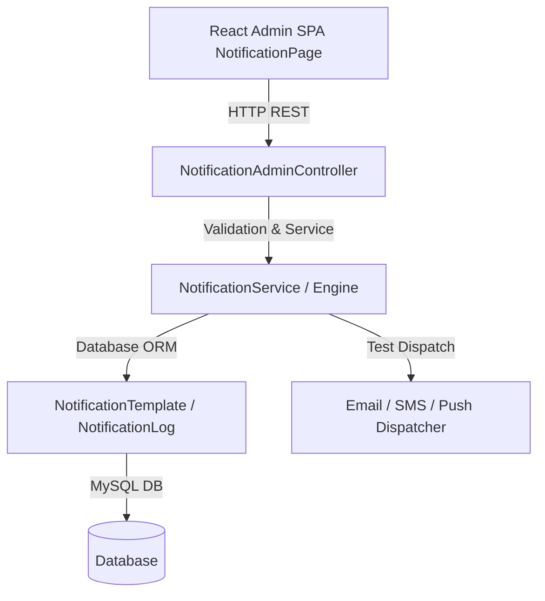

# Development Plan: Module 33 — Admin Notification Templates & Delivery Logs

## 1. Module Summary
**Module Name**: Module 33 — Admin Notification Templates & Delivery Logs  
**Layer**: Admin API Backend & React Admin SPA Frontend  
**Specification Reference**: `specifications/feature.admin-notifications.spec.md`  

---

## 2. Development Strategy
Follow the mandatory iterative workflow defined in `instruction.md`:
1. Database Schema & Migration check for `notification_templates` and `notification_logs`.
2. Laravel Models (`NotificationTemplate`, `NotificationLog`).
3. Laravel API Controller (`NotificationAdminController`) & Route Registrations in `routes/api.php`.
4. React Admin SPA View (`resources/js/admin/pages/NotificationPage.jsx`) & Router Registration in `App.jsx`.
5. Automated Backend PHPUnit Feature Tests (`tests/Feature/Admin/NotificationAdminTest.php`).
6. Automated Playwright E2E Integration Tests (`tests/e2e/admin-notifications.spec.js`).
7. Asset Build (`npm run build`) & Verification.

---

## 3. Architecture

---

## 4. Task Breakdown

- [x] **Task 1: Generate Specification Document** (`specifications/feature.admin-notifications.spec.md`)
- [x] **Task 2: Generate Development Plan Document** (`plans/plan.admin-notifications.md`)
- [x] **Task 3: Generate Test Cases Document** (`plans/test-cases.admin-notifications.md`)
- [x] **Task 4: Generate Regression Strategy Document** (`plans/regression.admin-notifications.md`)
- [ ] **Task 5: Database Migrations & Enhancements**
  - Verify / update `notification_templates` and `notification_logs` tables.
- [ ] **Task 6: Eloquent Models & Service Layer**
  - Enhance `NotificationTemplate.php` & `NotificationLog.php`.
  - Add variable parser helper & mock data payload generator.
- [ ] **Task 7: Laravel Admin API Controller & Routes**
  - Implement `NotificationAdminController.php`: `indexTemplates`, `showTemplate`, `storeTemplate`, `updateTemplate`, `toggleStatus`, `testDispatch`, `indexLogs`, `retryLog`.
  - Register API endpoints in `routes/api.php`.
- [ ] **Task 8: React Admin SPA Component (`NotificationPage.jsx`)**
  - Executive KPI cards, channel tabs (Email, SMS, Push, Logs), Search & Toolbar filters, Template Editor Modal with live preview, Delivery Log Viewer Modal with retry capability.
  - Register `/notifications` route in `App.jsx` and sidebar link under `System Config`.
- [ ] **Task 9: Automated PHPUnit Feature Tests**
  - Create `tests/Feature/Admin/NotificationAdminTest.php` covering template CRUD, test dispatch, delivery logs, and error handling.
- [ ] **Task 10: Automated Playwright E2E Integration Tests**
  - Create `tests/e2e/admin-notifications.spec.js` testing page navigation, tab switching, editor modal, preview, and log inspection.
- [ ] **Task 11: Production Build & Final Verification**
  - Run `npm run build` and execute full unit & E2E suite.
