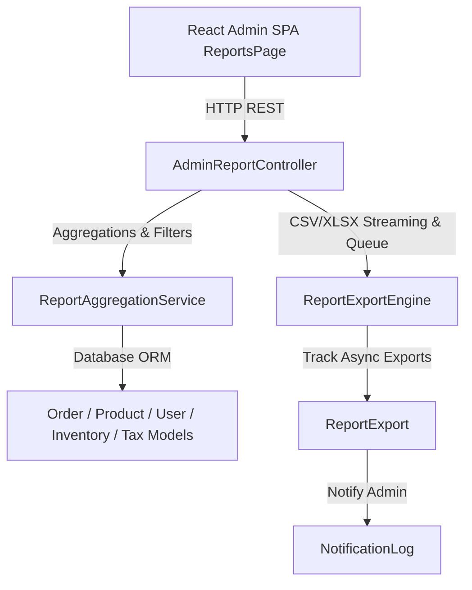

# Development Plan: Module 34 — Admin Reports & Exports

## 1. Module Summary
**Module Name**: Module 34 — Admin Reports & Exports  
**Layer**: Admin API Backend & React Admin SPA Frontend  
**Specification Reference**: `specifications/feature.admin-reports.spec.md`  

---

## 2. Development Strategy
Follow the mandatory iterative workflow defined in `instruction.md`:
1. Create Database Migration `2026_08_19_000007_create_report_exports_table.php` for tracking export jobs (`id`, `admin_id`, `report_type`, `format`, `status`, `file_path`, `file_size`, `filters`, `created_at`, `updated_at`).
2. Create Eloquent Model `App\Models\ReportExport.php`.
3. Create API Controller `App\Http\Controllers\Api\V1\Admin\AdminReportController.php` with endpoints for Sales, Orders, Products, Customers, Inventory, Tax, and Export streaming/queueing.
4. Register API routes in `routes/api.php` under `/api/v1/admin/reports/*`.
5. Create React Admin SPA Page `resources/js/admin/pages/ReportsPage.jsx` with tabs for all 6 reports, filter toolbar, KPI summary cards, interactive charts, and CSV/XLSX export modal.
6. Register `/reports` route and sidebar navigation link in `resources/js/admin/App.jsx`.
7. Write PHPUnit Feature Tests (`tests/Feature/Admin/AdminReportTest.php`).
8. Write Playwright E2E Integration Tests (`tests/e2e/admin-reports.spec.js`).
9. Compile Vite production assets (`npm run build`) and verify complete test suite.

---

## 3. Architecture

---

## 4. Component Changes

### Backend Component
- `[NEW] 2026_08_19_000007_create_report_exports_table.php`
- `[NEW] app/Models/ReportExport.php`
- `[NEW] app/Http/Controllers/Api/V1/Admin/AdminReportController.php`
- `[MODIFY] routes/api.php`

### Frontend Component
- `[NEW] resources/js/admin/pages/ReportsPage.jsx`
- `[MODIFY] resources/js/admin/App.jsx`

### Automated Tests
- `[NEW] tests/Feature/Admin/AdminReportTest.php`
- `[NEW] tests/e2e/admin-reports.spec.js`

---

## 5. Verification Plan

### Automated Tests
- Execute PHPUnit test suite: `docker exec ecom-panel-app php artisan test --filter=AdminReportTest`
- Execute Playwright E2E test suite: `npx playwright test tests/e2e/admin-reports.spec.js`

### Manual Verification
- Verify date range filtering across Sales, Orders, Products, Customers, Inventory, and Tax reports.
- Verify CSV export downloads and formatting.
