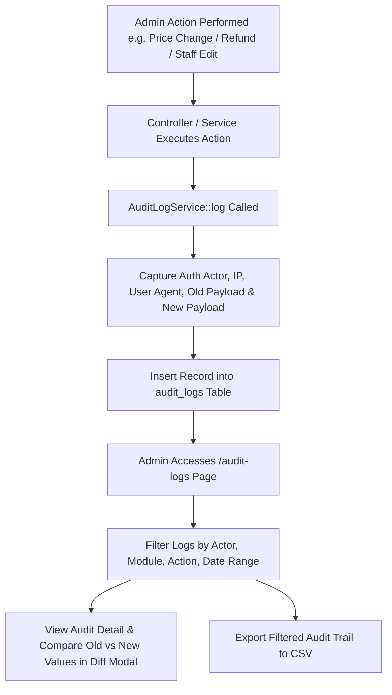

# Module Specification: Module 39 — Admin Audit Logs

**Module Name:** Admin Audit Logs & Activity Trail  
**Layer:** Admin API & Admin React Panel  
**Priority:** Medium  
**SRS References:** §85, admin_panel.md §37, §54, development_modules.md Module 39  
**Spec File:** `specifications/feature.admin-audit-logs.spec.md`  
**Plan File:** `plans/plan.admin-audit-logs.md`  
**Test Cases File:** `plans/test-cases.admin-audit-logs.md`  
**Regression File:** `plans/regression.admin-audit-logs.md`  

---

## 1. Module Overview

The **Admin Audit Logs** module provides a centralized, tamper-evident audit trail for all critical administrative operations across the ecommerce platform. It automatically records system activity whenever an admin user alters sensitive data—such as product pricing, stock adjustments, order cancellations, refunds, coupon updates, tax configurations, payment settings, staff management, and customer status changes. 

The module features a high-performance database schema (`audit_logs`), a background-compatible `AuditLogService` helper, RESTful API endpoints for filtering and diff inspection, CSV reporting export, and a modern React executive dashboard for system administrators.

---

## 2. Business Flow



1. **Triggering Events**: Critical business actions in products, inventory, orders, refunds, coupons, taxes, settings, staff, and customer modules invoke `AuditLogService::log()`.
2. **Context Enrichment**: The system automatically attaches the current authenticated Sanctum admin actor (`actor_id`, `actor_name`, `actor_email`), client IP address, user agent, module tag, action code, target entity type, entity ID, and old vs new JSON snapshots.
3. **Audit Inspection**: Super Admins and authorized staff view audit logs with real-time filters, searchable JSON payload diffs, and CSV reporting capabilities.

---

## 3. Functional Requirements

### 3.1 Automatic Event Auditing
The system **MUST** automatically create audit log entries for the following 12 core event categories:
1. **Product Price Change**: `product.price_change` (old vs new `price`, `sale_price`).
2. **Product Delete/Archive**: `product.delete` or `product.archive` (target product snapshot).
3. **Inventory Adjustment**: `inventory.adjustment` (stock changes, reason, warehouse/variant).
4. **Order Cancellation**: `order.cancel` (cancellation reason, refund amount).
5. **Refund Processing**: `order.refund` (refund ID, amount, method, gateway reference).
6. **Coupon Create/Update**: `coupon.create` or `coupon.update` (discount value, code, expiry).
7. **Tax Configuration Change**: `tax.update` (rate change, zone, tax rules).
8. **Payment Setting Change**: `payment_setting.update` (gateway status, mode, keys).
9. **Shipping Setting Change**: `shipping_setting.update` (shipping zone, rate, rule changes).
10. **Admin User Creation & Updates**: `admin.create`, `admin.update`, `admin.status_change`, `admin.reset_access`.
11. **Role & Permission Changes**: `role.create`, `role.update`, `role.delete`.
12. **Customer Status Change**: `customer.status_change` (active, suspended, banned).

### 3.2 Audit Log Fields & Trait/Service Infrastructure
Each audit log entry must store:
- `actor_id`: Foreign key to `admin_users` (nullable for system background tasks).
- `actor_name`: Snapshot string of admin name at time of event.
- `actor_email`: Snapshot string of admin email.
- `action`: Dot-notation action string (e.g. `product.price_change`, `order.cancel`).
- `module`: Top-level module tag (`products`, `inventory`, `orders`, `refunds`, `coupons`, `taxes`, `settings`, `staff`, `roles`, `customers`).
- `entity_type`: Model class name or entity tag (`Product`, `Order`, `TaxRule`, `AdminUser`).
- `entity_id`: Primary key string or ID of target record.
- `old_values`: JSON column storing previous state values.
- `new_values`: JSON column storing updated state values.
- `ip_address`: IPv4 or IPv6 client IP address (45 chars).
- `user_agent`: Browser/Client User-Agent string.
- `created_at`: Event timestamp.

### 3.3 Admin Log Viewer UI & Filtering
- **Executive Metrics Cards**: Total Audit Logs, Audit Events Today, Active Admin Actors Count, Critical Action Count.
- **Filters Toolbar**:
  - Search Input (searches `actor_name`, `actor_email`, `entity_id`, `action`).
  - Module Select (`products`, `orders`, `inventory`, `coupons`, `taxes`, `settings`, `staff`, `roles`, `customers`).
  - Action Select (dynamic options based on selected module).
  - Admin Actor Dropdown.
  - Date Range (`date_from`, `date_to`).
- **Data Table**: Paginated display with sortable columns, formatted timestamp, actor badges, action pills, entity preview, and "View Diff" button.
- **Diff Modal**: Visual side-by-side or highlighted JSON difference viewer showing exactly what fields changed between `old_values` and `new_values`.
- **CSV Export**: Export filtered audit records to CSV for compliance audits.

---

## 4. Technical Requirements

- **PHP / Laravel Framework**: Laravel 11.x, Sanctum authentication, Spatie RBAC permissions.
- **Database Indexing**: Compound indexes on `(module, created_at)`, `(actor_id, created_at)`, `(action, created_at)` for high-performance log querying.
- **Standardized API Response**: Controller uses `App\Traits\ApiResponseTrait` for all responses (`successResponse`, `errorResponse`).
- **Frontend Framework**: React 18 with Inertia/Vite, Lucide React icons, dark/light theme standard admin CSS styling.

---

## 5. Database Schema Changes

### `audit_logs` Table Migration

```sql
CREATE TABLE audit_logs (
    id BIGINT UNSIGNED AUTO_INCREMENT PRIMARY KEY,
    actor_id BIGINT UNSIGNED NULL,
    actor_name VARCHAR(191) NOT NULL,
    actor_email VARCHAR(191) NOT NULL,
    action VARCHAR(100) NOT NULL,
    module VARCHAR(50) NOT NULL,
    entity_type VARCHAR(100) NULL,
    entity_id VARCHAR(100) NULL,
    old_values JSON NULL,
    new_values JSON NULL,
    ip_address VARCHAR(45) NULL,
    user_agent TEXT NULL,
    created_at TIMESTAMP NULL DEFAULT CURRENT_TIMESTAMP,
    updated_at TIMESTAMP NULL DEFAULT CURRENT_TIMESTAMP ON UPDATE CURRENT_TIMESTAMP,
    FOREIGN KEY (actor_id) REFERENCES admin_users(id) ON DELETE SET NULL,
    INDEX idx_audit_module_created (module, created_at),
    INDEX idx_audit_actor_created (actor_id, created_at),
    INDEX idx_audit_action_created (action, created_at),
    INDEX idx_audit_entity (entity_type, entity_id)
) ENGINE=InnoDB DEFAULT CHARSET=utf8mb4 COLLATE=utf8mb4_unicode_ci;
```

---

## 6. API Requirements

### 6.1 `GET /api/v1/admin/audit-logs`
- **Query Parameters**:
  - `page` (int, default: 1)
  - `per_page` (int, default: 15, max: 100)
  - `search` (string, optional)
  - `module` (string, optional)
  - `action` (string, optional)
  - `actor_id` (int, optional)
  - `date_from` (date string YYYY-MM-DD, optional)
  - `date_to` (date string YYYY-MM-DD, optional)
  - `sort_by` (string, default: `created_at`)
  - `sort_order` (string, `asc`|`desc`, default: `desc`)
- **Response `200 OK`**:
```json
{
    "success": true,
    "message": "Audit logs retrieved successfully.",
    "data": [
        {
            "id": 102,
            "actor_id": 1,
            "actor_name": "Super Admin",
            "actor_email": "admin@example.com",
            "action": "product.price_change",
            "module": "products",
            "entity_type": "App\\Models\\Product",
            "entity_id": "45",
            "old_values": { "price": 99.99, "sale_price": null },
            "new_values": { "price": 89.99, "sale_price": 79.99 },
            "ip_address": "127.0.0.1",
            "user_agent": "Mozilla/5.0 ...",
            "created_at": "2026-08-22T09:30:00.000000Z"
        }
    ],
    "meta": {
        "current_page": 1,
        "last_page": 10,
        "per_page": 15,
        "total": 145
    }
}
```

### 6.2 `GET /api/v1/admin/audit-logs/{id}`
- **Response `200 OK`**: Detailed payload diff for modal inspection.

### 6.3 `GET /api/v1/admin/audit-logs/export`
- **Query Parameters**: Same filters as `GET /api/v1/admin/audit-logs`.
- **Response**: File download stream (`Content-Type: text/csv`, filename `audit_logs_YYYYMMDD_HHMMSS.csv`).

### 6.4 `GET /api/v1/admin/audit-logs/modules`
- **Response `200 OK`**: Returns available modules, action types, and active actors for filter options.

---

## 7. UI Requirements

- **Page Component**: `resources/js/admin/pages/AuditLogsPage.jsx`
- **Route**: `/audit-logs`
- **KPI Summary Cards**:
  1. Total Logged Events
  2. Events Logged Today
  3. Active Admin Actors
  4. Security & Role Audit Events
- **Interactive Diff Viewer Modal**: Side-by-side comparison formatted with green (`+ added`), red (`- removed`), and yellow (`~ modified`) diff highlights.

---

## 8. Validation Rules

- `date_from` / `date_to`: Must be valid date format (`YYYY-MM-DD`). `date_to` must be equal to or after `date_from`.
- `per_page`: Integer between 1 and 100.
- `module`: Must match one of the allowed system module tags.

---

## 9. Permission Rules

- `permission:audit-logs.view` -> Required for viewing audit log list and detailed diffs.
- `permission:audit-logs.export` -> Required for downloading CSV audit reports.

---

## 10. Business Rules

1. **Immutable Log Entries**: Audit log records cannot be updated or deleted by standard API endpoints to maintain audit compliance and integrity.
2. **Actor Snapshots**: `actor_name` and `actor_email` are snapshotted on creation so that even if an admin user account is later renamed or deleted, historical audit logs preserve the exact actor details.
3. **Fail-Safe Logging**: If audit logging fails during a transaction, the primary business transaction must complete smoothly without crashing, while logging the error in application logs.

---

## 11. Acceptance Criteria

- [x] Database migration creates `audit_logs` table with proper indexes and FKs.
- [x] `AuditLogService` provides central logging API capturing actor, action, module, diff payloads, IP, and user-agent.
- [x] All 12 critical business action categories (price change, product delete, inventory adjust, cancel order, refund, coupon edit, tax edit, setting edit, staff edit, role edit, customer status) write audit logs.
- [x] `AdminAuditLogController` provides paginated listing, filters, diff detail view, and CSV export.
- [x] React Admin UI `AuditLogsPage.jsx` displays metrics, search/filter toolbar, data table, and modal diff inspector.
- [x] All routes protected by Sanctum auth and RBAC permissions (`permission:audit-logs.view`).
- [x] Automated PHPUnit test suite `AdminAuditLogTest` passes 100% cleanly.

---

## 12. Edge Cases

- **Deleted Admin Actor**: Historical audit log entries preserve snapshotted `actor_name` and `actor_email` even after admin user row is removed (`FK nullOnDelete`).
- **Large Old/New Payload Objects**: JSON columns store up to 64KB objects without truncation.
- **Bulk Adjustments**: Fast single-query or chunked batch inserts for bulk inventory or price changes.
- **Unauthenticated Background Tasks**: Actor ID null, `actor_name` set to `"System / Automated Job"`.
