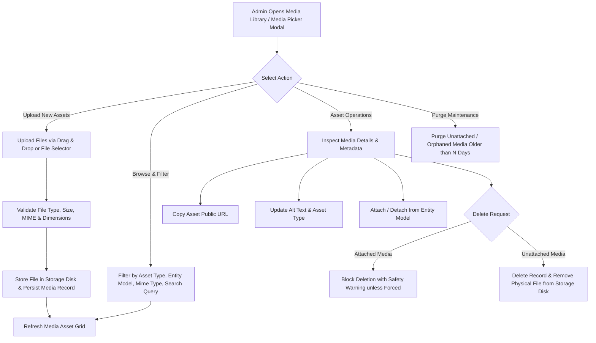

# Feature Specification: Module 36 — Admin Media Library

## 1. Module Overview
**Module Name**: Module 36 — Admin Media Library  
**Layer**: Admin API & React Admin SPA  
**Priority**: Medium  
**SRS References**: `admin_panel.md` §31, `development_modules.md` §Module 36, `srs_apis.md` §83–§85  

### Purpose
Provide a centralized, enterprise-grade media asset management library for store administrators. The Media Library serves as the single source of truth for all image assets, banners, documents, and product gallery media utilized across Products, Categories, Brands, Banners, and CMS Pages. Administrators can upload single or batch files, filter assets by MIME type/entity binding, inspect file metadata, edit alt text, copy CDN/Media URLs, delete unattached media safely, and purge orphaned media files.

---

## 2. Business Flow

---

## 3. Functional Requirements

### 3.1 Centralized Media Asset Management (`MediaLibraryPage.jsx`)
1. **Grid & List View**:
   - Visual grid view displaying thumbnail previews, file names, file sizes, MIME badges, and entity attachment tags.
   - List table view displaying file details, upload dates, model attachments, and quick actions.
2. **Filtering & Search Controls**:
   - **Search Query**: Real-time filtering by file name, original filename, alt text, or file extension.
   - **Asset Type**: Filter by `main`, `gallery`, `thumbnail`, `banner`, `document`.
   - **Entity Association**: Filter by `product`, `category`, `brand`, `banner`, `cms_page`, or `unattached_only`.
   - **MIME Type**: Filter by Image (`image/*`), PDF (`application/pdf`), Document (`text/*`).
3. **File Upload Engine**:
   - Multi-file drag and drop support.
   - File validation: MIME type check, maximum file size (10MB default), image dimension extraction (`width`, `height`).
   - Progress bar indicators during uploads.

---

### 3.2 Asset Operations & Maintenance
1. **Media Details & Metadata Inspector**:
   - Preview high-resolution image/document.
   - Display file size, dimensions, MIME type, storage path, creation date, and attached entity.
2. **One-Click URL Copy**:
   - Direct button to copy full CDN/public URL to clipboard with toast notification feedback.
3. **Metadata Editing**:
   - Edit alt text (for accessibility and SEO) and asset type classification.
4. **Safety-Checked Deletion**:
   - Block accidental deletion of assets actively attached to Products, Categories, or Brands.
   - Require explicit force deletion flag if overriding attachment safeguards.
5. **Orphaned Asset Purge**:
   - Provide a bulk purge tool to clean up unattached media assets older than N days.

---

### 3.3 Reusable Media Picker Modal (`MediaLibraryModal.jsx`)
- Reusable modal popup integration for selecting or uploading media assets directly within Product form, Category edit, Brand edit, and Banner administration screens.
- Seamless single-select or multi-select modes with attachment callbacks.

---

## 4. API Endpoint Definitions

| Endpoint Path | Method | Description | Access |
|---|---|---|---|
| `/api/v1/admin/media` | GET | List paginated media assets with filters & search | Admin Sanctum |
| `/api/v1/admin/media/{id}` | GET | Get single media asset detail & metadata | Admin Sanctum |
| `/api/v1/admin/media/upload` | POST | Upload single or batch media files | Admin Sanctum |
| `/api/v1/admin/media/attach` | POST | Attach existing media asset to entity model | Admin Sanctum |
| `/api/v1/admin/media/detach` | POST | Detach media asset from entity model | Admin Sanctum |
| `/api/v1/admin/media/{id}` | PUT | Update media metadata (alt text, type, sort order) | Admin Sanctum |
| `/api/v1/admin/media/sort` | POST | Bulk reorder media gallery items | Admin Sanctum |
| `/api/v1/admin/media/{id}` | DELETE | Delete media asset (with safety check) | Admin Sanctum |
| `/api/v1/admin/media/unused` | DELETE | Purge orphaned unattached media files | Admin Sanctum |

---

## 5. Security & RBAC Controls

- Require Sanctum authentication guard for `admin_users`.
- Require `Media.View` permission to browse the library.
- Require `Media.Upload` permission to upload new files.
- Require `Media.Delete` permission to delete assets or execute bulk purge operations.
