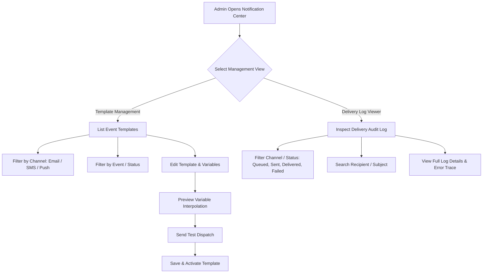

# Feature Specification: Module 33 — Admin Notification Templates & Delivery Logs

## 1. Module Overview
**Module Name**: Module 33 — Admin Notification Templates & Delivery Logs  
**Layer**: Admin API & React Admin SPA  
**Priority**: Medium  
**SRS References**: `admin_panel.md` §38–§39, `srs_apis.md`  

### Purpose
Provide a complete administration management system for multi-channel notification templates (Email, SMS, Push Notification) triggered by store events (Order Placed, Order Shipped, Payment Confirmation, Return Requested, Refund Processed, Review Approved, OTP Verification, Password Reset). The module enables store administrators to customize subject lines, HTML/text body templates with dynamic handlebars-style variable interpolation (`{{customer_name}}`, `{{order_number}}`, `{{grand_total}}`, `{{tracking_number}}`, `{{otp_code}}`, etc.), toggle channel status, send test dispatches, and inspect complete delivery logs with recipient, channel, status, timestamps, and failure error trace diagnosis.

---

## 2. Business Flow

---

## 3. Functional Requirements

### 3.1 Template Management
- **Event-Based Architecture**: Support event triggers:
  - `order_placed`, `order_shipped`, `order_cancelled`, `payment_success`, `return_requested`, `refund_processed`, `review_approved`, `otp_verify`, `password_reset`.
- **Multi-Channel Support**: Support `email`, `sms`, and `push` channels per template event.
- **Dynamic Handlebars Variables**:
  - `{{customer_name}}`, `{{customer_email}}`, `{{customer_mobile}}`, `{{order_number}}`, `{{order_total}}`, `{{tracking_number}}`, `{{carrier_name}}`, `{{refund_amount}}`, `{{otp_code}}`, `{{store_name}}`, `{{support_email}}`.
- **Live Preview & Test Dispatch**:
  - Send real-time test emails/SMS/push notifications to a designated test recipient with mock data payloads.
- **Activate / Deactivate Toggle**:
  - Instantly enable or disable template sending per channel.

### 3.2 Delivery Log Viewer
- **Audit Logs**: Record recipient address/phone, channel, template used, delivery status (`queued`, `sent`, `delivered`, `failed`), sent timestamp, and raw error trace if failed.
- **Log Filters & Search**: Filter by status, channel, date range, and search by recipient email or mobile number.
- **Log Retries**: Admin can retry failed notification dispatches from the delivery log interface.

---

## 4. Technical Requirements

### 4.1 Database Schemas & Migrations
Existing tables `notification_templates` and `notification_logs` (or enhancement migrations if needed):
- `notification_templates`:
  - `id` (bigint, primary)
  - `event_key` (string, e.g., `order_shipped`)
  - `channel` (enum: `email`, `sms`, `push`)
  - `name` (string)
  - `subject` (string, nullable)
  - `body_html` (text, nullable)
  - `body_text` (text)
  - `variables` (json, list of allowed variables)
  - `is_active` (boolean, default true)
  - `created_at`, `updated_at`
- `notification_logs`:
  - `id` (bigint, primary)
  - `template_id` (foreignId, nullable)
  - `event_key` (string)
  - `channel` (enum: `email`, `sms`, `push`)
  - `recipient` (string)
  - `subject` (string, nullable)
  - `body` (text)
  - `status` (enum: `queued`, `sent`, `delivered`, `failed`)
  - `error_message` (text, nullable)
  - `sent_at` (timestamp, nullable)
  - `created_at`, `updated_at`

---

## 5. API Requirements (`/api/v1/admin/notifications`)

### 5.1 `GET /api/v1/admin/notifications/templates`
- **Description**: Fetch listing of templates filtered by channel, event, status.
- **RBAC**: `permission:notifications.view`

### 5.2 `GET /api/v1/admin/notifications/templates/{id}`
- **Description**: Get detailed single template structure & allowed variables.
- **RBAC**: `permission:notifications.view`

### 5.3 `POST /api/v1/admin/notifications/templates`
- **Description**: Create a new custom event notification template.
- **RBAC**: `permission:notifications.create`

### 5.4 `PUT /api/v1/admin/notifications/templates/{id}`
- **Description**: Update template subject, HTML body, text body, and status.
- **RBAC**: `permission:notifications.update`

### 5.5 `PATCH /api/v1/admin/notifications/templates/{id}/toggle-status`
- **Description**: Toggle template active/inactive state.
- **RBAC**: `permission:notifications.update`

### 5.6 `POST /api/v1/admin/notifications/test-dispatch`
- **Description**: Dispatch test email/SMS/push to given recipient address.
- **RBAC**: `permission:notifications.update`

### 5.7 `GET /api/v1/admin/notifications/logs`
- **Description**: Paginated delivery log listing with channel, status, search, and date filters.
- **RBAC**: `permission:notifications.view`

### 5.8 `POST /api/v1/admin/notifications/logs/{id}/retry`
- **Description**: Retry dispatching a failed notification log.
- **RBAC**: `permission:notifications.update`

---

## 6. React Admin SPA View (`NotificationPage.jsx`)

### 6.1 Layout & Components
- **Page Top Header Row**: `className="page-header-row"` with title `Notification Templates & Delivery Audit`, subtitle description, and Refresh button.
- **4 KPI Metric Cards**:
  - `Total Templates`: Count of registered event templates.
  - `Active Templates`: Count of active templates.
  - `Sent Notifications`: 24h/Total delivery count.
  - `Failed Delivery Rate`: Count of failed log entries with warning highlight.
- **Top Navigation Tabs**:
  - `Email Templates`, `SMS Templates`, `Push Notifications`, `Delivery Audit Logs`.
- **Template Editor Modal**:
  - Rich subject line & HTML/Text editor with variable chip insertion bar (`{{customer_name}}`, `{{order_number}}`, etc.).
  - Live variable preview box.
  - Test dispatch input form.
- **Delivery Log Detail Modal**:
  - Full recipient info, rendered body content, status timeline, and raw error trace log parser.

---

## 7. Validation & RBAC Permissions
- **Validation Rules**:
  - `channel`: Required, `in:email,sms,push`.
  - `name`: Required, max 100 characters.
  - `event_key`: Required, max 50 characters.
  - `body_text`: Required when creating/updating.
  - `recipient`: Required email or phone for test dispatch.
- **Permissions**:
  - `notifications.view`
  - `notifications.create`
  - `notifications.update`
  - `notifications.delete`

---

## 8. Acceptance Criteria
- [ ] Admin can view template listing grouped or filtered by channel (`email`, `sms`, `push`).
- [ ] Admin can edit template subject line and body text with variable placeholders.
- [ ] Live preview updates instantly as variables are edited.
- [ ] Admin can send test notifications to a test address/phone number.
- [ ] Delivery log viewer displays accurate sent/delivered/failed status with error details.
- [ ] Failed notification logs can be retried with a single click.
- [ ] PHPUnit feature tests pass with 100% assertions.
- [ ] Playwright E2E tests pass cleanly.
