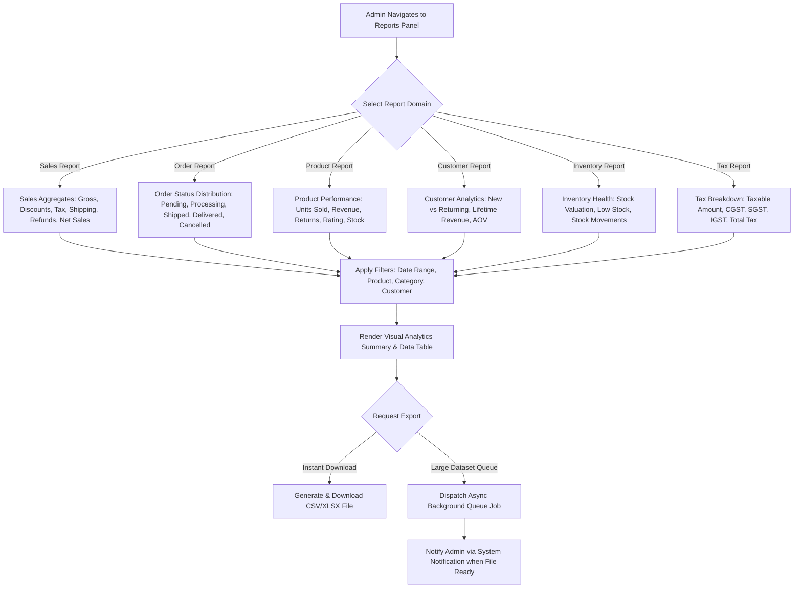

# Feature Specification: Module 34 — Admin Reports & Exports

## 1. Module Overview
**Module Name**: Module 34 — Admin Reports & Exports  
**Layer**: Admin API & React Admin SPA  
**Priority**: Medium  
**SRS References**: `admin_panel.md` §32–§33, `srs_apis.md` §62–§65  

### Purpose
Provide an enterprise-grade reporting analytics and export generation engine for store administrators. The module aggregates store-wide transactional data into 6 specialized reporting domains: Sales Report, Order Status Report, Product Performance Report, Customer Analytics Report, Inventory Movement Report, and Tax Breakdown Report (CGST/SGST/IGST). Administrators can filter data by date range, category, product, and customer, view visual KPI cards and data tables, and trigger asynchronous or instant report exports in CSV/XLSX formats with system notifications upon file completion.

---

## 2. Business Flow

---

## 3. Functional Requirements

### 3.1 Report Domains & Metric Aggregation

1. **Sales Report**:
   - **Metrics**: Gross Sales, Total Discounts, Tax Collected, Shipping Fees Charged, Total Refunded Amount, Net Sales (`Gross - Discounts - Refunds + Shipping + Tax`).
   - **Filters**: Start Date, End Date, Product ID/Name, Category ID, Customer ID.
   - **Breakdown**: Grouping by Day, Week, Month, or Year.

2. **Order Status Report**:
   - **Metrics**: Total Order Count, Total Order Value, Completed/Delivered Orders, Pending/Processing Orders, Cancelled Orders, Returned Orders.
   - **Distribution**: Percentage breakdown per order status with date filtering.

3. **Product Performance Report**:
   - **Metrics**: SKU, Product Title, Units Sold, Total Revenue Generated, Units Returned, Current Stock Level, Average Rating.
   - **Filters**: Category filter, Low stock threshold filter, Search query.

4. **Customer Analytics Report**:
   - **Metrics**: Total Customers Count, New Customers (Registered in Date Range), Returning Customers (Count of customers with >1 order), Lifetime Revenue per Customer, Average Order Value (AOV = `Total Revenue / Total Orders`).

5. **Inventory Report**:
   - **Metrics**: Total Stocked SKUs, Total Inventory Quantity, Total Stock Valuation (`Quantity * Cost/Price`), Low Stock SKU Count, Out-of-Stock SKU Count, Inventory Audit Movements (Stock In, Stock Out, Adjustments).

6. **Tax Breakdown Report**:
   - **Metrics**: Gross Taxable Sales Amount, CGST Amount, SGST Amount, IGST Amount, Total Tax Collected.
   - **Compliance**: GST breakdown per tax slab (0%, 5%, 12%, 18%, 28%).

---

### 3.2 Report Export Engine (CSV & XLSX)

- **Formats**: Support CSV (`.csv`) and XLSX Excel (`.xlsx`) downloads across all 6 report types.
- **Filtering Alignment**: Exported files strictly match active filter selections (date range, category, product, customer).
- **Asynchronous Queue-Based Exports for Large Datasets**:
  - Automatically dispatch queue jobs for large export requests (>1,000 records).
  - Generate export file asynchronously in storage.
  - Send an Admin Notification (`notification_logs`) when export generation completes with download URL.

---

## 4. API Endpoint Definitions

| Endpoint Path | Method | Description | Access |
|---|---|---|---|
| `/api/v1/admin/reports/sales` | GET | Fetch Sales Report metrics & breakdown | Admin Sanctum |
| `/api/v1/admin/reports/orders` | GET | Fetch Order Status Report metrics | Admin Sanctum |
| `/api/v1/admin/reports/products` | GET | Fetch Product Performance Report metrics | Admin Sanctum |
| `/api/v1/admin/reports/customers` | GET | Fetch Customer Analytics Report metrics | Admin Sanctum |
| `/api/v1/admin/reports/inventory` | GET | Fetch Inventory Health & Movements Report | Admin Sanctum |
| `/api/v1/admin/reports/tax` | GET | Fetch Tax Breakdown Report (CGST/SGST/IGST) | Admin Sanctum |
| `/api/v1/admin/reports/export` | POST | Trigger instant or queued CSV/XLSX export | Admin Sanctum |

---

## 5. Security & RBAC Controls

- Require Sanctum authentication guard for `admin_users`.
- Require `Reports.View` permission to view report dashboards.
- Require `Reports.Export` permission to download or queue CSV/XLSX exports.
